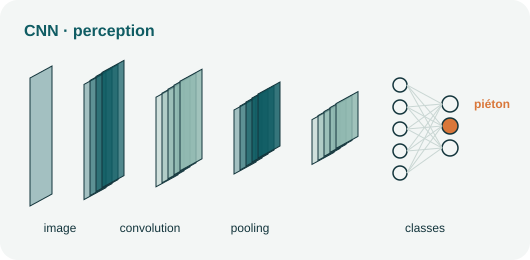
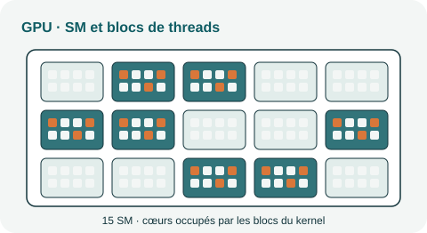
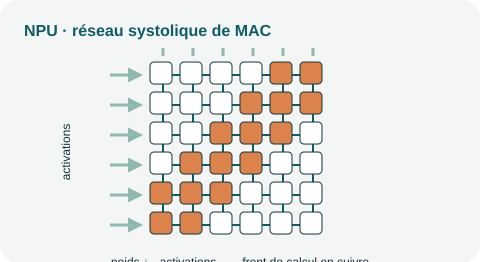
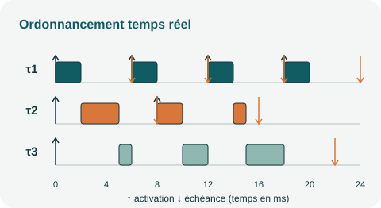
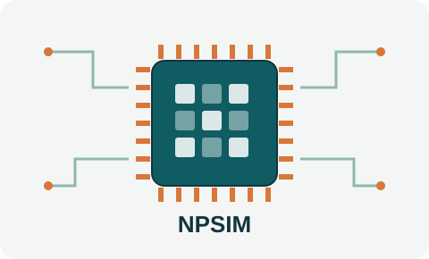

# Recherche

Je suis membre du [Laboratoire d'Informatique Gaspard-Monge (LIGM, CNRS UMR 8049)](https://ligm.univ-eiffel.fr)
de l'Université Gustave Eiffel, au sein de l'équipe LRT.

Mes travaux portent sur la conception et la vérification des systèmes embarqués critiques,
en particulier l'analyse d'ordonnancement temps réel. J'ai soutenu ma thèse de doctorat en
informatique à l'Université de Bretagne Occidentale (Brest) en 2019, après un diplôme
d'ingénieur en télécommunications de SUP'COM (2015).

## Thèmes de recherche

-   

    **IA temps réel**

    Implémentation temps réel des algorithmes d'IA et des réseaux de neurones profonds (DNN).

-   

    **DNN sur GPU**

    Nouveaux modèles de tâches pour exécuter des DNN temps réel sur GPU.

-   

    **Réseaux sur puce (NoC)**

    Routeurs NoC pour systèmes à criticité mixte et modèles de communication sur puce.

-   

    **Analyse d'ordonnançabilité**

    Analyse conjointe des tâches et des messages, systèmes à criticité mixte.

## NPSIM

[{ width="320" }](npsim.md)

NPSIM est un simulateur CPU–NPU précis au tick près, conçu pour analyser
l'ordonnancement des applications CNN temps réel. [En savoir plus →](npsim.md)

## Projets et encadrement

- [Projets de recherche](projets.md) : un projet ANR et un projet CIFRE.
- [Stages encadrés](encadrement.md) : stages de master et de fin d'études sur l'IA temps réel, les GPU et les NPU.

## Publications

Liste complète et à jour sur mon profil
[Google Scholar](https://scholar.google.com/citations?user=CFmoyZIAAAAJ&hl=fr).

### 2026

- **M. Dridi, G. Salman, B. Bastug, M. F. Basibüyük.** *NPSIM: A Tick-Accurate CPU–NPU Simulator for Scheduling Analysis of CNN Applications.*
  IEEE CoDIT 2026, pp. 575–580. [IEEE](https://ieeexplore.ieee.org/abstract/document/11630789/)

### 2025

- **Y. Abdeddaïm, M. Dridi, J. Dumont.** *Research directions for real-time implementation of AI algorithms.*
  Real-Time Systems, 2025. [DOI](https://doi.org/10.1007/s11241-025-09439-7)

### 2023

- **M. Dridi, Y. Abdeddaïm, C. Daini.** *Work In Progress: A New Task Model for Real-Time DNNs over GPU.*
  IEEE RTAS 2023. [DOI](https://doi.org/10.1109/RTAS58335.2023.00035)

### 2021

- **M. Dridi, F. Singhoff, S. Rubini, J.-P. Diguet.** *ECTM: A network-on-chip communication model to combine task and message schedulability analysis.*
  Journal of Systems Architecture, 2021. [DOI](https://doi.org/10.1016/j.sysarc.2020.101931)

### 2019

- **M. Dridi, S. Rubini, M. Lallali, M. J. Sepúlveda Flórez, F. Singhoff, J.-P. Diguet.** *Design and Multi-Abstraction-Level Evaluation of a NoC Router for Mixed-Criticality Real-Time Systems.*
  ACM Journal on Emerging Technologies in Computing Systems, 2019.
- **M. Dridi.** *Vers le support des systèmes à criticité mixte sur des architectures NoC.*
  Thèse de doctorat, Université de Bretagne Occidentale, 2019. [HAL](https://tel.archives-ouvertes.fr/tel-02926475)

### 2017

- **M. Dridi, S. Rubini, F. Singhoff, J.-P. Diguet.** *DTFM: a flexible model for schedulability analysis of real-time applications on NoC-based architectures.*
  ACM SIGBED Review, 2017. [DOI](https://doi.org/10.1145/3177803.3177812)
- **M. Dridi, M. Lallali, S. Rubini, F. Singhoff, J.-P. Diguet.** *Modeling and Validation of a Mixed-Criticality NoC Router Using the IF Language.*
  NoCArc 2017. [DOI](https://doi.org/10.1145/3139540.3139543)
- **M. Dridi, S. Rubini, M. Lallali, M. J. Sepúlveda Flórez, F. Singhoff, J.-P. Diguet.** *DAS: An Efficient NoC Router for Mixed-Criticality Real-Time Systems.*
  IEEE ICCD 2017. [DOI](https://doi.ieeecomputersociety.org/10.1109/ICCD.2017.42)

### 2015

- **M. Dridi, M. M. Hafidhi, C. Winstead, E. Boutillon.** *Reliable NCO carrier generators for GPS receivers.*
  DASIP 2015. [DOI](https://doi.org/10.1109/DASIP.2015.7367266)
