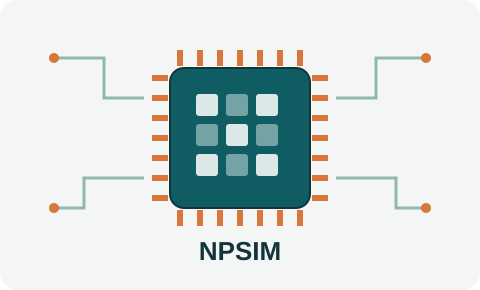

# NPSIM

**NPSIM** est un simulateur CPU–NPU *tick-accurate* (précis au cycle d'horloge près)
dédié à l'analyse d'ordonnancement des applications à base de réseaux de neurones convolutifs (CNN).

[Lire l'article (IEEE CoDIT 2026)](https://ieeexplore.ieee.org/abstract/document/11630789/){ .md-button .md-button--primary }

## Contexte

Les systèmes autonomes (véhicules, drones, robots) s'appuient sur des CNN pour la perception
et la prise de décision. Ces traitements sont soumis à des contraintes temporelles strictes :
une inférence qui manque son échéance compromet la sécurité du système.

Dans l'embarqué, les NPU (*Neural Processing Units*) remplacent progressivement les GPU pour
accélérer l'inférence. Mais ces architectures sont pensées pour le débit : leur exécution est
non préemptive et elles n'offrent pas de garanties temps réel natives. Leur comportement
temporel est donc difficile à prévoir, ce qui complique leur intégration dans des systèmes
temps réel.

## Ce que permet NPSIM

- Simuler finement l'exécution conjointe CPU–NPU d'applications CNN.
- Observer le comportement temporel des tâches d'inférence, tick par tick.
- Évaluer des politiques d'ordonnancement et vérifier le respect des échéances.

## Publication

**M. Dridi, G. Salman, B. Bastug, M. F. Basibüyük.**
*NPSIM: A Tick-Accurate CPU–NPU Simulator for Scheduling Analysis of CNN Applications.*
2026 12th International Conference on Control, Decision and Information Technologies (CoDIT),
IEEE, pp. 575–580, juillet 2026.
[IEEE Xplore](https://ieeexplore.ieee.org/abstract/document/11630789/)
